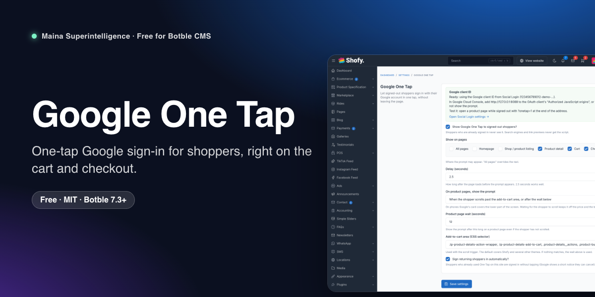
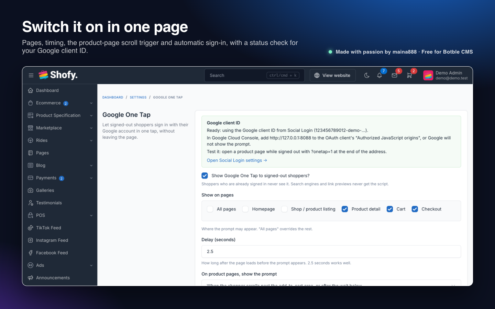
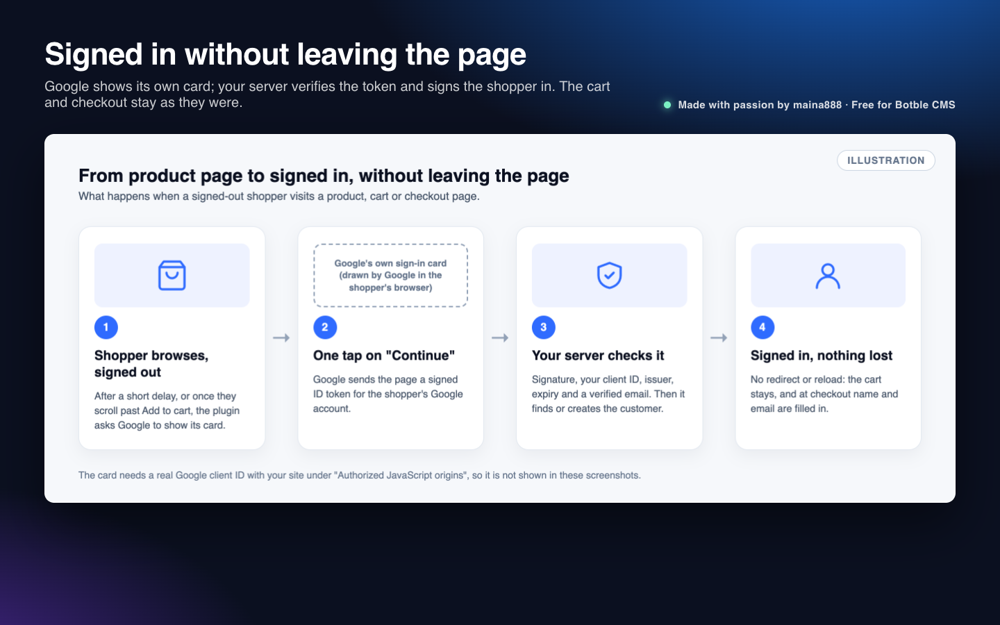
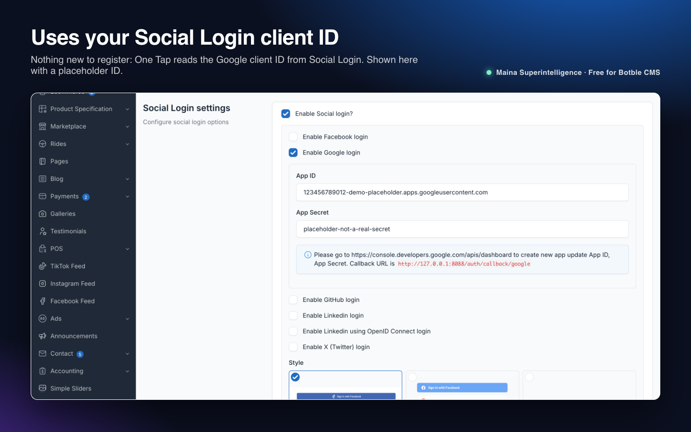
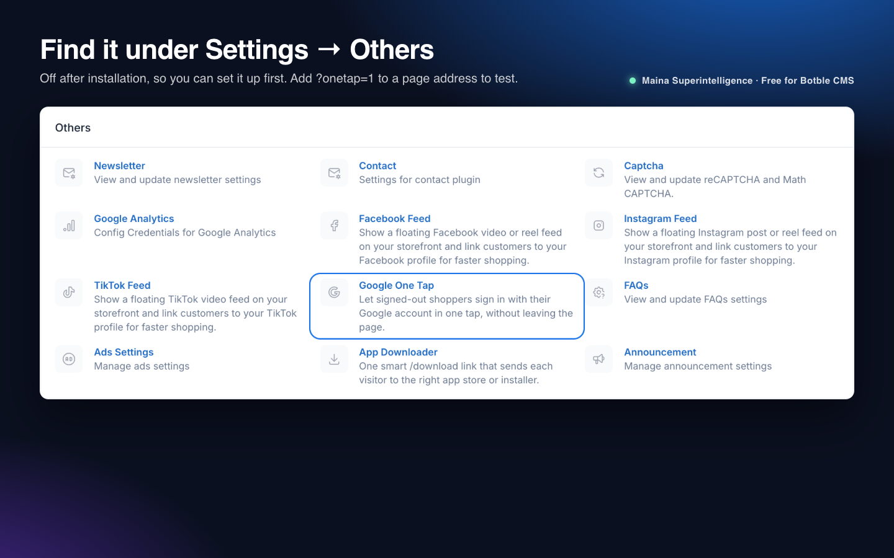

Let shoppers sign in with their Google account in one tap, right on the product, cart or checkout page. No redirect and no page reload, so the cart and anything already typed at checkout stay where they are.

**Free and open source** by **Maina 888** · Maina Superintelligence Ltd

**Version:** 1.0.0 · **Requires:** Botble CMS core 7.3.0+, PHP 8.2+, Ecommerce and Social Login plugins · **License:** MIT

## Features

- **Google One Tap** for signed-out shoppers: Google shows its own "Continue as …" card, the shopper taps once and is signed in as a customer.
- **Returning shoppers** who used it before are signed in automatically (can be turned off).
- **New shoppers** get a customer account created from their verified Google email and name, linked to Google the same way the Social Login plugin links accounts.
- **No reload:** the session, cart and CSRF token are kept. At checkout the name and email fields are filled in if they are empty. Shofy's header is updated in place; on other themes the page reloads once (never at checkout).
- **Choose the pages:** product pages, cart and checkout by default, or homepage, shop listing or all pages.
- **Polite timing:** a delay before the prompt, and on product pages it can wait until the shopper scrolls past the add-to-cart area (or stays a few seconds), so it doesn't cover the price on phones.
- **Secure:** the Google ID token is verified on the server (signature, your client ID as audience, issuer, expiry and verified email) before anyone is signed in. Locked accounts are refused. The login endpoint is rate-limited.
- **Uses your existing Google client ID** from Social Login, so there is nothing new to register.
- **Skips bots:** search engines, link previews and headless browsers never get the script.
- **Settings page** with a status check and an artisan command to switch it on or off.

## Screenshots

| Settings | How it works |
| --- | --- |
|  |  |
| **Google client ID in Social Login** | **Where to find it** |
|  |  |

The sign-in card itself is drawn by Google in the shopper's browser and needs a real Google client ID, so the screenshots show the settings and an illustration instead.

## Requirements

- Botble CMS core 7.3.0 or later, PHP 8.2 or later.
- The **Ecommerce** plugin (customer accounts) and the **Social Login** plugin (the Google client ID), both active.
- A Google OAuth client ID (type "Web application") from [Google Cloud Console](https://console.cloud.google.com/apis/credentials), with your site's address under **Authorized JavaScript origins**.
- HTTPS on the live site (Google requires it, except on `localhost`).

## Installation

### From the Botble Marketplace (recommended)

1. Go to **Admin → Plugins → Add new**.
2. Search for **Google One Tap**, click **Install**, then **Activate**.

Updates appear in **Admin → Plugins** whenever a new version is released.

### From a release zip

1. Download `one-tap-x.y.z.zip` from the [latest release](https://github.com/Themaina/maina-one-tap/releases/latest).
2. Go to **Admin → Plugins → Add new → Upload**, pick the zip, then **Activate**.

### Manually

1. Copy the `one-tap` folder to `platform/plugins/one-tap`.
2. Go to **Admin → Plugins** and click **Activate** (or run `php artisan cms:plugin:activate one-tap`).

The plugin creates no tables. It is **off** after installation until you switch it on.

## Getting started

1. In Google Cloud Console, open your OAuth client (or create one of type *Web application*) and add your site, e.g. `https://shop.example.com`, under **Authorized JavaScript origins**.
2. In **Admin → Settings → Social Login**, turn on Social Login and Google, and enter the client ID (and secret, which the normal Google button uses).
3. In **Admin → Settings → Others → Google One Tap**, check that the status box says *Ready*, tick **Show Google One Tap to signed-out shoppers**, and save.
4. Open a product page in a private window while signed in to Google in that browser. The card appears after the delay.

To try it before switching it on for everyone, add `?onetap=1` to a product, cart or checkout address: the prompt is shown on that page load only.

## Configuration

**Admin → Settings → Others → Google One Tap**

| Setting | What it does |
| --- | --- |
| Show Google One Tap to signed-out shoppers | Master switch. Signed-in customers never see the prompt. |
| Show on pages | Product detail, cart and checkout by default. Also homepage, shop listing, or all pages. |
| Delay (seconds) | Wait after the page loads before asking Google to show the card. Default 2.5. |
| On product pages, show the prompt | *When the shopper scrolls past the add-to-cart area, or after the wait below* (default), or *After the same delay as other pages*. |
| Product page wait (seconds) | Used with the scroll trigger. Default 12. |
| Add-to-cart area (CSS selector) | The element the scroll trigger watches. The default covers Shofy and several other themes; add your theme's selector if it differs. If nothing matches, the wait is used. |
| Sign returning shoppers in automatically | Google's auto sign-in for shoppers who already used One Tap here. Google shows a short notice they can cancel. |

The defaults live in `config/one-tap.php` and are used until you save the settings page.

## Usage

| What | How |
| --- | --- |
| Switch on/off from the command line | `php artisan one-tap:switch on` or `php artisan one-tap:switch off` |
| Test on one page | Add `?onetap=1` to the address (Social Login must be set up). |
| Login endpoint | `POST /one-tap/login` with `credential` (the Google ID token) and the CSRF token. Limited to 20 requests a minute per visitor. Returns the customer's name and email as JSON. |
| Analytics | If `gtag` is on the page, a `login` or `sign_up` event with method `Google One Tap` is sent. |

## How it works

1. On an allowed page, for a signed-out visitor who is not a bot, the plugin adds a small inline script to the theme footer.
2. After the delay (or the scroll trigger on product pages) the script loads Google Identity Services from `accounts.google.com` and asks Google to show the One Tap card. Before that moment nothing is loaded from Google.
3. When the shopper taps *Continue*, Google gives the page an ID token, which the script posts to `/one-tap/login`.
4. The server verifies the token with `google/apiclient` (installed with Social Login), or with Google's tokeninfo endpoint if that library is missing, and checks the audience, issuer, expiry and that the email is verified.
5. The customer is found by email (or by an existing Google link), or created with a random password and a confirmed email, linked to Google, and signed in with "remember me".
6. The page updates without a reload. Nothing else about the visitor is stored.

## Troubleshooting

| Problem | Fix |
| --- | --- |
| No card appears | Check the status box on the settings page, that you are signed out of the shop, signed in to Google in that browser, and on a page ticked under *Show on pages*. Google also stops showing the card for a while after a shopper closes it several times (its "cool-down"); try a private window. |
| Browser console says the origin is not allowed | Add the exact site address (scheme, host and port) under **Authorized JavaScript origins** for the client ID. Changes can take a few minutes. |
| "We could not confirm your Google account." | The token was for a different client ID, expired, or the Google email is not verified. Make sure Social Login uses the same client ID as the one shown on the Google card's site. |
| "This account is locked." | The customer account with that email is locked in **Ecommerce → Customers**. |
| The header still says "Login / Register" | On themes other than Shofy the page reloads after sign-in. If it does not, check the browser console for script errors from other plugins. |
| It shows on a page where you don't want it | Untick that page under *Show on pages*. |

## Uninstall

Remove the plugin from **Admin → Plugins**. All `one_tap_*` settings are deleted. Customer accounts created through One Tap are normal customers and stay, as do their Social Login links.

## Development

Unit tests cover page matching, bot detection and the ID-token checks:

```bash
composer require --dev phpunit/phpunit
vendor/bin/phpunit -c platform/plugins/one-tap/phpunit.xml.dist
```

## File structure

```
one-tap/
├── plugin.json
├── config/{one-tap.php, permissions.php}
├── resources/{lang/en, views}
├── routes/web.php
├── src/{Commands, Forms, Http, Providers, Support, Plugin.php}
├── tests/
└── art/            (marketplace images, not shipped in the zip)
```

## Support

- Questions and bug reports: [GitHub issues](https://github.com/Themaina/maina-one-tap/issues)
- Security problems: see [SECURITY.md](https://github.com/Themaina/maina-one-tap/blob/main/SECURITY.md)
- Changes in each version: [CHANGELOG.md](https://github.com/Themaina/maina-one-tap/blob/main/CHANGELOG.md)

Google is a trademark of Google LLC. This plugin is not affiliated with or endorsed by Google.

## License

Free and open source under the [MIT License](https://github.com/Themaina/maina-one-tap/blob/main/LICENSE). © 2026 Maina Superintelligence Ltd. Made by Maina 888.
